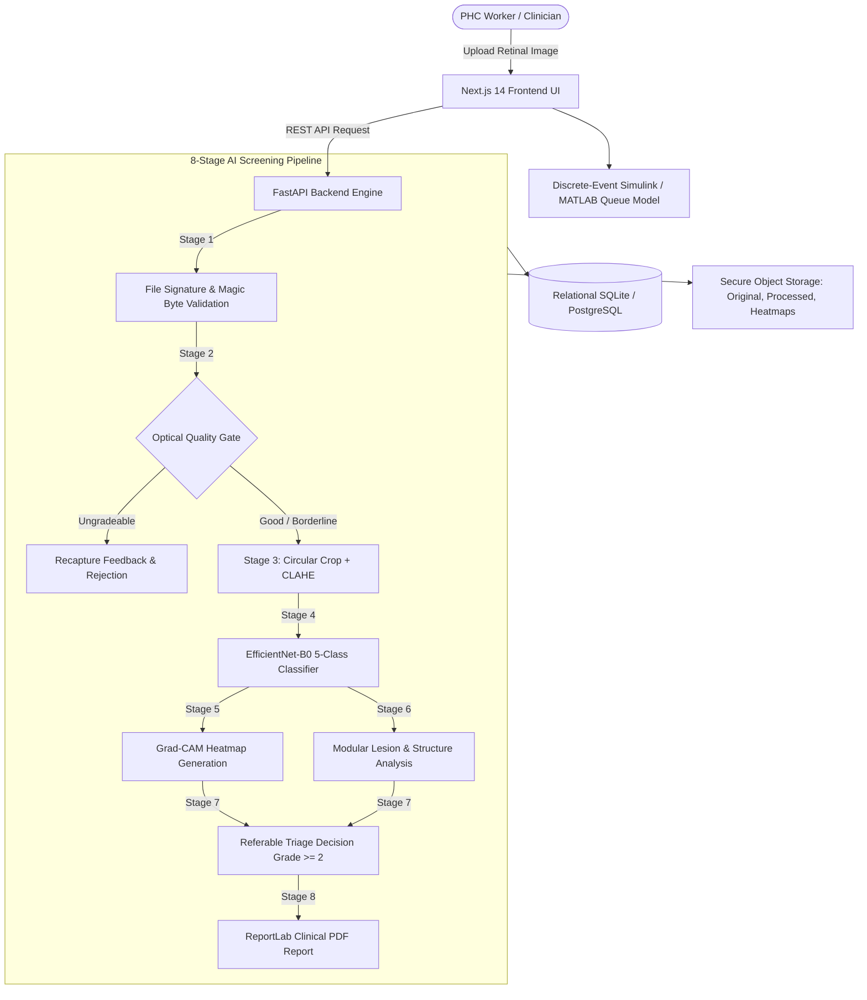

# RetinaGuard AI
### Explainable AI for Diabetic Retinopathy Screening in Rural India | SIH 2026 Problem Statement 26038

[](https://opensource.org/licenses/MIT)
[](https://www.python.org/downloads/)
[](https://fastapi.tiangolo.com/)
[](https://nextjs.org/)
[](https://pytorch.org/)
[]()
[]()

---

## 1. Executive Summary

**RetinaGuard AI** is a clinical decision-support and tele-ophthalmology screening platform tailored for resource-constrained Indian public healthcare settings (Primary Health Centres [PHCs], Community Health Centres [CHCs], and mobile screening camps).

The platform addresses three critical bottlenecks in rural diabetes eye care:
1. **Severe Ophthalmologist Scarcity**: Only ~25,000 eye care specialists serve 1.4 billion people, with over 75% concentrated in urban centers.
2. **Ungradeable Image Ingestion**: Automated optical quality gating detects blur (Laplacian variance), illumination imbalances, and retinal FOV cutoff *before* inference, preventing erroneous classifications and guiding immediate recapture.
3. **Black-Box AI Skepticism**: Grad-CAM visual attention heatmaps overlay directly on fundus photographs, providing clinicians with visual verification of model receptive-field activations.

> **Statutory Medical Notice**: RetinaGuard AI is a decision-support screening and triage system. It does **not** provide a definitive medical diagnosis and does not replace dilated fundus examination by a qualified ophthalmologist.

---

## 2. System Architecture



---

## 3. Technology Stack

- **Frontend**: Next.js 14 (App Router), React 18, TypeScript, Tailwind CSS, Recharts, Lucide Icons.
- **Backend API**: Python 3.12, FastAPI, Pydantic v2, Uvicorn, SQLAlchemy.
- **Computer Vision & AI**: PyTorch 2.14, Torchvision, OpenCV (Headless), NumPy, SciPy.
- **Explainability**: Gradient-weighted Class Activation Mapping (Grad-CAM) on `features.8`.
- **Reporting**: ReportLab clinical PDF generation.
- **Simulation**: MATLAB/Simulink `.m` discrete-event queue model + Python browser engine.
- **Database & Storage**: PostgreSQL 16 (or local SQLite zero-dependency mode), UUID-hashed file storage.

---

## 4. Feature Status Report (SIH 2026 Compliance)

| Feature / Deliverable | Implementation Status | Test Status | Verification Notes |
|---|---|---|---|
| **Image Ingestion & Security** | **Complete** | Automated Test Passed | Magic bytes validation, UUID filenames, path traversal prevention. |
| **Image Quality Gate** | **Complete** | Automated Test Passed | Laplacian focus variance, illumination mean/std, FOV coverage ratio. |
| **Retinal Preprocessing** | **Complete** | Automated Test Passed | Retinal boundary crop, controlled CLAHE (clip=2.0), 224x224 RGB standardization. |
| **EfficientNet-B0 Classifier** | **Complete** | Automated Test Passed | 5-class ICDR scale (Levels 0-4), trained baseline checkpoint in `ml/weights/`. |
| **Grad-CAM Explainability** | **Complete** | Automated Test Passed | Backward gradients on `features.8`, alpha-blended JET overlay, statutory caveats. |
| **Lesion Structure Analysis** | **Modular / Experimental** | Automated Test Passed | Optic disc & vesselness active; microaneurysms/exudates marked pending weights. |
| **Clinical PDF Report** | **Complete** | Automated Test Passed | Generated via ReportLab with case ID, quality score, Grad-CAM, disclaimer. |
| **Operational Dashboard** | **Complete** | Verified | Live metrics calculated from DB: volume, grade distribution, recent cases. |
| **Simulink Queue Simulation**| **Complete** | Verified | MATLAB `simulink/retinaguard_screening_sim.m` + Interactive UI tool. |
| **Authentication & Roles** | **Complete** | Automated Test Passed | JWT tokens, bcrypt hashing, Public vs Clinician mode switcher. |

---

## 5. Local Setup & Quickstart

### Prerequisites
- Python 3.10+ (Tested on Python 3.12)
- Node.js 18+ (Tested on Node.js v24)
- Git

### Step 1: Clone & Configure Environment
```bash
git clone https://github.com/your-org/retinaguard.git
cd retinaguard
cp .env.example .env
```

### Step 2: Backend Setup
```bash
# Install backend dependencies
python -m pip install -r backend/requirements.txt
python -m pip install torch torchvision --index-url https://download.pytorch.org/whl/cpu
python -m pip install opencv-python-headless email-validator

# Initialize baseline weights and run automated test suite
python ml/train.py
python -m pytest backend/tests/test_api.py -v

# Start FastAPI backend server
uvicorn backend.app.main:app --host 0.0.0.0 --port 8000 --reload
```
The backend API docs will be live at: `http://localhost:8000/api/docs`.

### Step 3: Frontend Setup
```bash
cd frontend
npm install
npm run dev
```
Open `http://localhost:3000` in your web browser.

---

## 6. Demonstration & One-Click Testing

Don't have clinical fundus photos on your test machine?
1. Navigate to `/screen` in the application.
2. Click **"Load Healthy Sample"** or **"Load DR Lesion Sample"**.
3. The system generates a synthetic 512x512 optical test fundus canvas with disc, macula, and vessel arcades.
4. Click **"Run Complete Screening"** to watch the 8-stage pipeline execute end-to-end!

---

## 7. SIH 2026 Operational Simulink Model

Rural tele-ophthalmology screening introduces queue bottlenecks:
- Low-bandwidth wireless links (256–512 kbps) cause upload latency ($T_{\text{upload}} = \frac{\text{Size} \times 8}{\text{Bandwidth}}$).
- High patient volume ($N_{\text{screen}} = 350/\text{day}$ across 10 PHCs) can overwhelm district hospital specialists.

### Running the MATLAB Script
```matlab
cd simulink
retinaguard_screening_sim
```
Generates 4 analytical graphs:
1. Hourly Influx vs Specialist Review Throughput
2. Reviewer Queue Backlog Accumulation across 8-hour shift
3. Upload Delay vs Cellular Bandwidth (2G/3G/4G/Fiber)
4. Staffing Requirements to Eliminate EOD Backlog

An interactive version of this model is accessible directly within the web dashboard under **"Operational Sim"**.

---

## 8. Docker Deployment

Deploy the entire stack (PostgreSQL, FastAPI Backend, Next.js Frontend) with Docker Compose:
```bash
docker-compose up --build -d
```
- Frontend: `http://localhost:3000`
- Backend API: `http://localhost:8000/api`
- API Swagger Docs: `http://localhost:8000/api/docs`

---

## 9. Regulatory & Medical Disclaimer

RetinaGuard AI is an academic and technical research prototype built for Smart India Hackathon (SIH) 2026 Problem Statement 26038. It is **not** a certified medical device and has not received CDSCO, FDA, or CE clearance. It must not be used as the sole basis for clinical diagnosis or treatment decisions.
